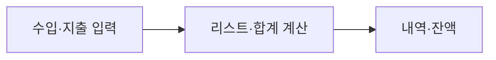

# B2-1 · 00단계 | 쉽고 작은 학습부터 시작하기

**30초 요약:** 이 미션은 **Python으로 수입·지출 관리**에 대해 배웁니다. 첫 번째 용어는 <mark>리스트(List)</mark>입니다. **개념 하나 → 그림 하나 → 질문 하나**를 이해한 후 다음으로 넘어가면 됩니다.

> **00단계: 계획 문서 작성** · **01 공식 요구: DOC 작성, 3회 QA 중** · **새 코드: NOT_STARTED / 승인 PENDING** · **실행·학습 성취: NOT_VERIFIED**

**읽는 순서:** 10초에 목표 파악 → 1분에 첫 개념 그림 보기 → 5분에 자기 설명·종이 재현.

## 00단계의 4개 학습 영역

| 영역 | 바로가기 |
|---|---|
| A. 처음 시작하기 | [시작](#b21-00-start) |
| B. 기술 배우기 | [첫 개념·Mermaid](#b21-00-learn) |
| C. 진행 확인하기 | [현재 상태](#b21-00-status) |
| D. 상세 참고자료 | [더 알아보기](#b21-00-more) |

## A. 처음 시작하기

**무엇을 배우나요?** Python으로 수입·지출 관리. 공식 필수 요구사항은 **01단계**에서 평가표 원문과 연결합니다.

**아래에서 한 가지 출발점을 선택하세요.**

- 처음 배우기 → 아래 **B. 기술 배우기**
- 전체 개념도·기술 용어 미리보기 → [기술 학습 개요](TECHNICAL-LEARNING-OUTLINE.md)
- 현재 진행 상태만 확인 → 아래 **C. 진행 확인하기**

## B. 기술 배우기 — 오늘은 한 개념만

### 오늘의 용어: 리스트(List)

여러 지출 금액을 순서대로 담는 자료구조입니다. 예를 들어 3,000원과 2,000원을 나란히 관리할 수 있습니다.

**그림으로 보기 (교육용 개념도):**

**생각할 질문:** 리스트는 금액을 한 개만 저장할 수 있을까요?

**답과 이유:** 아니요. 여러 항목을 저장할 수 있습니다.

### 내 말로 설명·종이 재현 (Teach-back / Dry-run)

**두 문장으로 설명해 보세요.** 리스트(List)는 여러 항목을 순서대로 담습니다. 두 지출 금액을 순서대로 기록하면 각 값을 순회해 합계를 계산할 수 있습니다.

**종이에 실행 과정을 따라 그려 보세요.**

1. 입력: 금액 3000과 2000을 자료에 담는다고 가정.
2. 처리: 각 값을 순서대로 더함.
3. 예상 결과: 예상 합계 5000원을 설명.

**자주 헷갈리는 부분:** 리스트는 자동으로 수입·지출이 옳은지 검사해주지 않습니다. 검증 규칙과 계산 로직이 별도로 필요합니다.

<ins>이 활동은 실제 코드를 실행한 결과가 아닌 교육용 예상 흐름입니다.</ins> 심화 용어와 평가 질문은 [한글·영어·약어 용어표](TECHNICAL-LEARNING-OUTLINE.md)에서 확인하세요.

다음 개념은 [B2-1 기술 학습 9요소](TECHNICAL-LEARNING-OUTLINE.md)에서 하나씩 확인하세요. 전체 학습 흐름은 **용어 → 개념 → 비유 → 아키텍처 → 주요 코드 → 실행 흐름 → 오류 해결 → 실습 → 평가**입니다.

<ins>위 그림은 실제 신규 코드나 시험 결과가 아닙니다. 신규 설계는 03단계, 구현은 별도 승인 후 04단계입니다.</ins>

## C. 진행 확인하기

| 구분 | 상태 |
|---|---|
| **00단계 교육·계획 개요** | PLAN_ONLY — 문서 작성 |
| **01단계 공식 요구 분석** | 신규 문서 작성, 정적 QA 진행 |
| **03단계 상세 설계** | 03-1~03-8 문서 작성, 정적 QA 진행 |
| **04단계 신규 코드** | NOT_STARTED / 승인 PENDING |
| **실제 실행·슬라이드·학습자 숙달** | NOT_VERIFIED 또는 NOT_STARTED |

**중요:** 계획/자료 반영 PASS와 **미션 기능 PASS·학습자 MASTER**는 다릅니다. 이전 Round의 결과는 보존합니다.

## D. 상세 참고자료

| 더 알고 싶은 내용 | 문서 |
|---|---|
| **전체 00~09 실행계획** | [단계별 수행 마스터 계획](EXECUTION-MASTER-PLAN.md) |
| **01 요구·평가 추적표** | [공식 요구사항 23개 추적](../01-requirements/REQUIREMENT-TRACEABILITY.md) |
| **02 기존 자산 비교** | [archive·갭 분석](../02-analysis/LEGACY-GAP-ANALYSIS.md) |
| **03-1~03-8 설계 목차** | [상세 설계](../03-design/README.md) |
| 용어·아키텍처·학습 예정 코드 | [기술 학습 개요](TECHNICAL-LEARNING-OUTLINE.md) |
| PRIMM·AI 힌트·L1~L5 평가 계획 | [학습체계 계획](LEARNING-SYSTEM-PLAN.md) |
| 발표·학습·심화·복습 4종 자료 | [슬라이드 계획](SLIDE-PACKAGE-PLAN.md) |
| 후속 개발단계 | [01 요구](../01-requirements/README.md) · [02 분석](../02-analysis/README.md) · [03 설계](../03-design/README.md) |
| 전체 공통 교육 규칙 | [중앙 학습 표준](https://github.com/MetaStudy999/codyssey-basic/blob/main/standards/LEARNER-CENTERED-AI-LEARNING-STANDARD.md) |

**다음 단계:** 01·02 작성된 공식 기준과 과거 분석을 읽고 03 설계 문서를 차례로 검토합니다. 새로운 코드 개발·실행은 아직 승인되지 않았습니다.

---

## 기존 00단계 계획·승인 기록 (원문 보존)

**기존 제목:** B2-1 — 계획 및 승인

공식 요구·기존 구현·미완료 항목을 조사하고 목차·일정을 사용자와 협의합니다. 승인 전 개발 금지. 현재 PLAN_ONLY.

## 선행 단계

[01 공식 요구](../01-requirements/README.md) → [02 기존 분석](../02-analysis/README.md) → [03 신규 설계](../03-design/README.md). 계획 문서·승인 관리와 실제 구현·검증을 구분합니다.

## 4종 학습·발표 패키지 계획 (2026-10-26 승인)

[계획 확인](SLIDE-PACKAGE-PLAN.md) · 발표 16장 / 학습 45장 / 부록 15~25장 / 복습 1~2장. 별도 개발 승인 유지.

## 학습자 중심 AI 교육체계 (2026-10-26 승인)

[최종 학습 계획](LEARNING-SYSTEM-PLAN.md). M01~M16, PRIMM, H1~H4 힌트, L1~L5 평가, QG-01~08, 동등 사전·사후 평가, 간격 복습과 학습활동 자료 계획을 포함합니다. **교육자료 실물·미션 코드·학습 성과는 미착수**.

## 기술 학습 9요소 — 입문자용 개요 (2026-10-26)

[B2-1 기술 용어·개념·Mermaid 개념 아키텍처·주요 코드·실습·평가 안내](TECHNICAL-LEARNING-OUTLINE.md). **용어 → 개념 → 비유 → 아키텍처 → 주요 코드 → 실행 흐름 → 오류 해결 → 실습 → 평가**를 이번 미션 기술에 맞춰 적용합니다.

현재는 **PLAN_ONLY**이며 실제 신규 구현·실행·학습자 평가 **NOT_STARTED / NOT_VERIFIED**, 개발 승인 **PENDING**은 유지합니다.
