# B2-1 평가 16문항 — 코드 근거·모범 답변·Mermaid 상세 해설

> **대상:** 제2기 B2-1 「나만의 용돈 기입장 프로그램 만들기」, 필수 미션.  
> **문항 출처:** 저장소 루트 [`b2-1-evaluation.md`](../../../b2-1-evaluation.md)의 **기존 평가표 4영역·16개 점검 질문**. 질문 문구는 그 평가표를 기준으로 옮겼다. **제2기 공식 미션 PDF는 요구사항의 최우선 기준**이며, 이 답변서는 공식 기관이 발행한 별도 문답집이 아니라 실제 구현을 분석해 만든 학습·설명 자료다.  
> **실제 코드 기준:** `training/round-04-agent/04-src/budget_app/` (2026-10-30 확인). 이전 Round·원본 평가표를 덮어쓰지 않는다.  
> **검증 상태:** 저장된 기존 증빙은 WSL2 Python 3.12.3 **unittest 29/29, CLI 독립 프로세스 61회 PASS**를 기록한다. 본 문서 작성이 새 런타임 실행을 뜻하지 않으며 **사용자 직접 시연·구술·공식 동료평가·CLEAR는 NOT_VERIFIED**다.

## 빠른 목차

| 평가영역 | 문항 | 질문 성격 | 현재 검증 근거 |
|---|---|---|---|
| E1 기능과 예외 | E1-01 ~ E1-07 | 실행·영속성·CSV·오류 처리 | 기존 실제 CLI·단위시험 결과 |
| E2 모듈과 클래스 | E2-01 ~ E2-03 | 책임 분리·저장 안전성 | 코드 구조·교체 실패 주입 |
| E3 언어 기능 | E3-01 ~ E3-03 | yield·Decorator·Type Hint | 정적 코드 감사 + 해당 기능 시험 |
| E4 포맷과 확장 | E4-01 ~ E4-03 | 기술 선택·성능 한계·부분 성공 | 코드·실제 소규모 재현, 10만 건 미측정 |

### 초보자를 위한 읽는 법

각 문항은 **원래 평가 질문 → 평가 의도 → 핵심 용어 → WHAT(무엇) → WHY(왜) → HOW(어떻게) → Mermaid(동작 그림) → 코드 근거 → VERIFY(검증) → LIMITATION(한계) → 10초/30초/1분 답변 → 추가 질문** 순서다. **모범 답변은 실습자의 구술을 대신하지 않는다.** 실제 사용자 시연에 성공한 경우에만 본인 증빙과 대조해 체크한다.

### 코드 경로·증빙 기준

- `04-src/budget_app/cli.py` — 사용자 입력·명령어·공통 오류
- `04-src/budget_app/service.py` — 거래·카테고리·예산·CSV 업무 규칙
- `04-src/budget_app/storage.py` — 3종 JSONL·제너레이터·원자적 파일 교체
- `04-src/budget_app/models.py` — `Transaction`·유효성·타입 계약
- [기존 독립 감사](../05-tests/WSL2-INDEPENDENT-VERIFICATION.md) · [기존 실행 증빙](../06-evidence/WSL2-RUNTIME-2026-10-30.md) · [unittest 원본](../06-evidence/WSL2-UNITTEST-2026-10-30.txt) · [CLI 원본](../06-evidence/WSL2-CLI-2026-10-30.txt)

## 평가 항목별 상세 답변

### E1-01. 주요 명령 10개 기능군

**기존 평가 질문:** `add/list/search/summary/export/import/update/delete`가 요구사항대로 동작하는가?

**평가자가 확인하려는 것:** 명령 인터페이스부터 데이터 검증·저장·출력까지 실제로 이어지는지 확인한다. 위 8개 명령 외에도 PDF 필수인 `budget`, `category`를 빠뜨리지 않는다.

**핵심 용어:** 명령줄 인터페이스(Command-Line Interface, CLI), 생성·조회·수정·삭제(Create, Read, Update, Delete, CRUD)

**모범 답변 — WHAT(무엇):** Python 표준 라이브러리로 거래 입력(add), 목록(list), 조건 검색(search), 월별 집계(summary), CSV 교환(import/export), 수정(update), 삭제(delete), 예산(budget), 카테고리(category)를 제공한다.

**WHY(왜 이 설계인가):** 단순 입력 출력이 아니라 입력 검증과 영속 저장까지 이어져야 사용 가능한 용돈 기입장이 된다.

**HOW(코드가 실제로 움직이는 방식):** `cli.py`의 `build_parser()`/`main()`이 명령을 해석하고 `BudgetService`의 메서드가 규칙을 처리하며 `Store`가 JSONL 파일에 반영한다. add는 `input()`으로 대화형 입력, update는 `--id`와 변경 필드 옵션 방식이다.

**Mermaid 구조도 / 흐름도**


**도식 해설:** 명령 종류는 다르지만 공통적으로 입력 해석 → 비즈니스 규칙 → 저장소 접근 → 사용자 출력의 경로를 지난다. 실패는 사용자에게 오류와 힌트를 돌려준다.

**내 구현 코드:** `cli.py:build_parser,main`; `service.py:BudgetService.add,list,search,summary,update,delete,import_csv,export_csv,set_budget,add_category,remove_category`. 위 경로의 함수명을 열고 입력값·반환값·실패 분기를 직접 보여주는 것이 답변의 근거다.

**VERIFY(시연·검증):** 테스트용 `--data-dir`에서 add→list→search→update→delete→budget→summary→category→export→import 순서로 시연한다. 기존 WSL2 CLI 61회 검증은 기록되어 있지만 새 사용자 직접 시연은 별도다. 참고 증빙은 `../05-tests/WSL2-INDEPENDENT-VERIFICATION.md`와 `../06-evidence/WSL2-RUNTIME-2026-10-30.md`다. **답변 작성 자체는 신규 PASS가 아니다.**

**LIMITATION(한계·대안):** 해당 도구는 로컬 1인용 파일 기반 콘솔 앱이며 웹·다중 사용자 거래 처리는 미션 범위 밖이다.

**10초 답변:** “입력 명령을 서비스에서 검증하고 JSONL 저장소에 반영하는 가계부입니다.”

**30초 답변 예시:** “Python 표준 라이브러리로 거래 입력(add), 목록(list), 조건 검색(search), 월별 집계(summary), CSV 교환(import/export), 수정(update), 삭제(delete), 예산(budget), 카테고리(category)를 제공한다. 단순 입력 출력이 아니라 입력 검증과 영속 저장까지 이어져야 사용 가능한 용돈 기입장이 된다.”

**1분 답변 구성:** ① 무엇을 만들었는가 — Python 표준 라이브러리로 거래 입력(add), 목록(list), 조건 검색(search), 월별 집계(summary), CSV 교환(import/export), 수정(update), 삭제(delete), 예산(budget), 카테고리(category)를 제공한다. ② 왜 이 방법인가 — 단순 입력 출력이 아니라 입력 검증과 영속 저장까지 이어져야 사용 가능한 용돈 기입장이 된다. ③ 실제 코드는 — `cli.py:build_parser,main`; `service.py:BudgetService.add,list,search,summary,update,delete,import_csv,export_csv,set_budget,add_category,remove_category` ④ 어떻게 확인하는가 — 테스트용 `--data-dir`에서 add→list→search→update→delete→budget→summary→category→export→import 순서로 시연한다. 기존 WSL2 CLI 61회 검증은 기록되어 있지만 새 사용자 직접 시연은 별도다. ⑤ 한계는 — 해당 도구는 로컬 1인용 파일 기반 콘솔 앱이며 웹·다중 사용자 거래 처리는 미션 범위 밖이다. 이 순서로 본인 말로 설명하고 해당 함수를 열어 보여준다.

**예상 추가 질문(공식 확정 문항 아님):** 왜 add만 대화형으로 입력하며, update는 어떤 방식을 선택했나요?

---
### E1-02. 재실행 후 3종 데이터 영속성

**기존 평가 질문:** 프로그램 재실행 후에도 거래·카테고리·예산 데이터가 유지되는가? (저장 파일 3개 이상)

**평가자가 확인하려는 것:** 프로그램 메모리가 사라져도 거래·카테고리·예산의 상태가 보존되는지 검사한다.

**핵심 용어:** 영속성(Persistence), 줄 단위 JSON(JSON Lines, JSONL)

**모범 답변 — WHAT(무엇):** `transactions.jsonl`, `categories.jsonl`, `budgets.jsonl`을 서로 다른 파일로 저장한다.

**WHY(왜 이 설계인가):** 프로그램을 끈 뒤에도 데이터가 남아야 하며, 서로 다른 성격의 값을 구분해 유지보수와 복구 범위를 명확하게 하기 때문이다.

**HOW(코드가 실제로 움직이는 방식):** `Store.__init__()`이 폴더와 3개 파일을 준비하고, `Store.save()`가 저장하며, 다음 CLI 실행에서 `Store.stream()`으로 다시 읽는다. 기본 분류가 비어 있으면 5개 기본 카테고리를 초기화한다.

**Mermaid 구조도 / 흐름도**

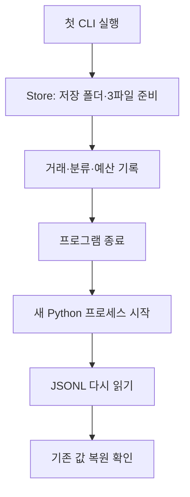

**도식 해설:** 종료 전후를 다른 Python 프로세스로 분리해야 메모리에만 남은 값과 진짜 파일 저장을 구별할 수 있다.

**내 구현 코드:** `storage.py:Store.__init__,path,stream,save`; `models.py:Transaction.from_dict`. 위 경로의 함수명을 열고 입력값·반환값·실패 분기를 직접 보여주는 것이 답변의 근거다.

**VERIFY(시연·검증):** 독립 프로세스로 거래 ID·추가 분류·월 예산을 저장한 뒤 다시 실행해서 3값과 파일 존재를 검사한다. 기존 실제 기록은 `06-evidence/WSL2-RUNTIME-2026-10-30.md`의 3종 영속성 표다. 참고 증빙은 `../05-tests/WSL2-INDEPENDENT-VERIFICATION.md`와 `../06-evidence/WSL2-RUNTIME-2026-10-30.md`다. **답변 작성 자체는 신규 PASS가 아니다.**

**LIMITATION(한계·대안):** 3개 파일 사이의 동시 원자적 일괄 갱신은 제공하지 않는다.

**10초 답변:** “거래·카테고리·예산을 각각 JSONL 파일에 저장해 프로그램을 다시 시작해도 복원됩니다.”

**30초 답변 예시:** “`transactions.jsonl`, `categories.jsonl`, `budgets.jsonl`을 서로 다른 파일로 저장한다. 프로그램을 끈 뒤에도 데이터가 남아야 하며, 서로 다른 성격의 값을 구분해 유지보수와 복구 범위를 명확하게 하기 때문이다.”

**1분 답변 구성:** ① 무엇을 만들었는가 — `transactions.jsonl`, `categories.jsonl`, `budgets.jsonl`을 서로 다른 파일로 저장한다. ② 왜 이 방법인가 — 프로그램을 끈 뒤에도 데이터가 남아야 하며, 서로 다른 성격의 값을 구분해 유지보수와 복구 범위를 명확하게 하기 때문이다. ③ 실제 코드는 — `storage.py:Store.__init__,path,stream,save`; `models.py:Transaction.from_dict` ④ 어떻게 확인하는가 — 독립 프로세스로 거래 ID·추가 분류·월 예산을 저장한 뒤 다시 실행해서 3값과 파일 존재를 검사한다. 기존 실제 기록은 `06-evidence/WSL2-RUNTIME-2026-10-30.md`의 3종 영속성 표다. ⑤ 한계는 — 3개 파일 사이의 동시 원자적 일괄 갱신은 제공하지 않는다. 이 순서로 본인 말로 설명하고 해당 함수를 열어 보여준다.

**예상 추가 질문(공식 확정 문항 아님):** 파일 세 개 중 한 개만 손상되면 어떻게 진단하나요?

---
### E1-03. 카테고리 등록·조회·삭제 정책

**기존 평가 질문:** `category add/list/remove`가 정상 동작하는가? (삭제 시 사용 중인 카테고리 처리 포함)

**평가자가 확인하려는 것:** 거래가 참조하는 분류를 무심코 삭제하지 않는 데이터 일관성을 확인한다.

**핵심 용어:** 참조 무결성(Referential Integrity), 데이터 검증(Validation)

**모범 답변 — WHAT(무엇):** 분류를 추가·열람·삭제할 수 있지만 해당 분류를 쓰는 거래가 존재하면 삭제를 거절한다.

**WHY(왜 이 설계인가):** 거래에 존재하지 않는 분류명이 남으면 검색과 요약 결과를 믿기 어렵기 때문이다.

**HOW(코드가 실제로 움직이는 방식):** `BudgetService.add_category()`는 이름·중복을 검사하고, `remove_category()`는 `transaction_stream()`을 돌며 사용 중인지 확인해 `BudgetError`로 삭제를 막는다.

**Mermaid 구조도 / 흐름도**

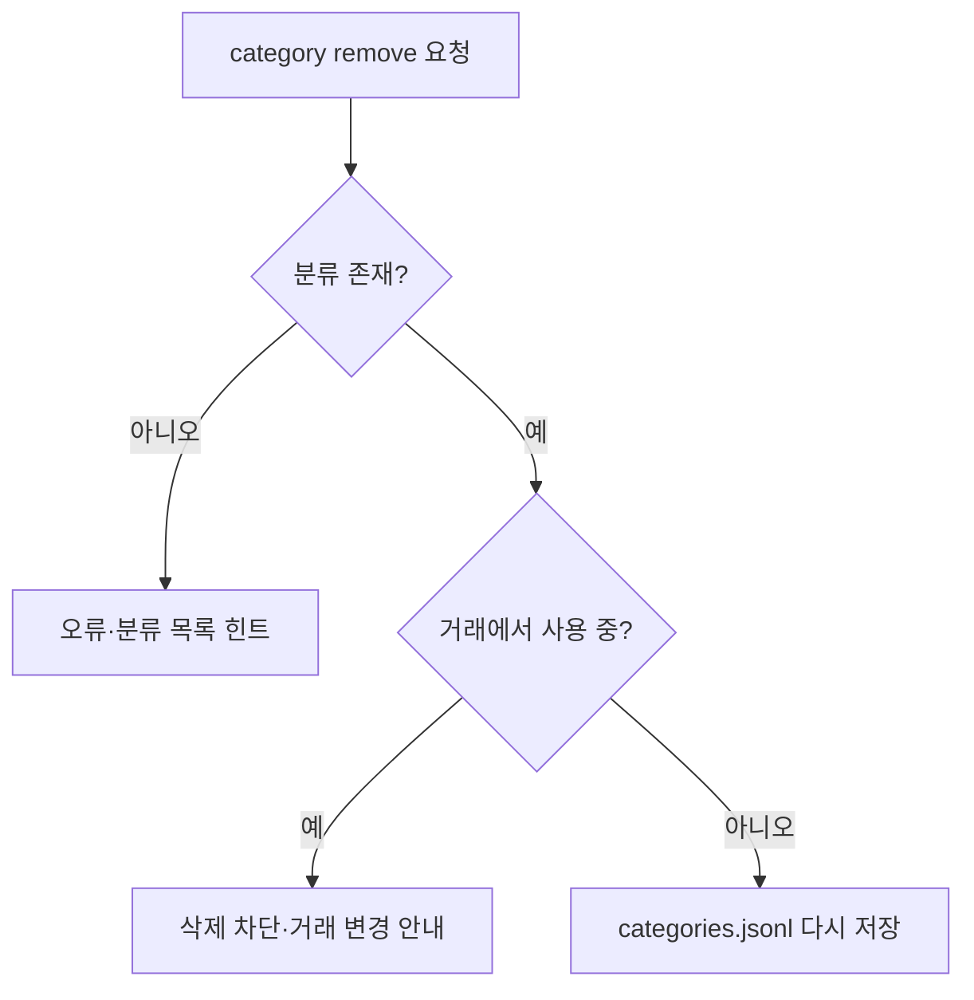

**도식 해설:** 없는 분류와 사용 중인 분류는 모두 삭제하지 않는다. 사용 중이면 관련 거래의 분류를 먼저 바꾸거나 거래를 정리한 뒤 삭제한다.

**내 구현 코드:** `service.py:add_category,categories,remove_category,require_category`; `storage.py:transaction_stream`. 위 경로의 함수명을 열고 입력값·반환값·실패 분기를 직접 보여주는 것이 답변의 근거다.

**VERIFY(시연·검증):** 임시 분류를 만들고 거래를 추가한 뒤 삭제 실패를 확인한다. 해당 거래를 삭제하면 같은 분류 삭제가 성공해야 한다. 참고 증빙은 `../05-tests/WSL2-INDEPENDENT-VERIFICATION.md`와 `../06-evidence/WSL2-RUNTIME-2026-10-30.md`다. **답변 작성 자체는 신규 PASS가 아니다.**

**LIMITATION(한계·대안):** 트랜잭션이 많을수록 사용 여부 검색은 순회 비용이 커진다.

**10초 답변:** “사용 중인 분류는 삭제하지 못하게 하여 거래 데이터의 의미를 지킵니다.”

**30초 답변 예시:** “분류를 추가·열람·삭제할 수 있지만 해당 분류를 쓰는 거래가 존재하면 삭제를 거절한다. 거래에 존재하지 않는 분류명이 남으면 검색과 요약 결과를 믿기 어렵기 때문이다.”

**1분 답변 구성:** ① 무엇을 만들었는가 — 분류를 추가·열람·삭제할 수 있지만 해당 분류를 쓰는 거래가 존재하면 삭제를 거절한다. ② 왜 이 방법인가 — 거래에 존재하지 않는 분류명이 남으면 검색과 요약 결과를 믿기 어렵기 때문이다. ③ 실제 코드는 — `service.py:add_category,categories,remove_category,require_category`; `storage.py:transaction_stream` ④ 어떻게 확인하는가 — 임시 분류를 만들고 거래를 추가한 뒤 삭제 실패를 확인한다. 해당 거래를 삭제하면 같은 분류 삭제가 성공해야 한다. ⑤ 한계는 — 트랜잭션이 많을수록 사용 여부 검색은 순회 비용이 커진다. 이 순서로 본인 말로 설명하고 해당 함수를 열어 보여준다.

**예상 추가 질문(공식 확정 문항 아님):** 왜 분류를 삭제하면서 거래의 카테고리를 자동 삭제하지 않나요?

---
### E1-04. 월 예산 및 초과 경고

**기존 평가 질문:** `budget set`이 저장되며, `summary`에서 예산 사용률과 초과 여부가 출력되는가?

**평가자가 확인하려는 것:** 설정된 예산이 월별 총지출 계산과 연결되는지 확인한다.

**핵심 용어:** 합계(Aggregation), 예산 사용률(Budget Utilization)

**모범 답변 — WHAT(무엇):** 월별 예산을 저장하고 요약 시 `총지출 / 월예산 × 100`으로 사용률을 계산하며 초과 시 경고한다.

**WHY(왜 이 설계인가):** 거래 목록만으로는 지출이 계획을 초과했는지 즉시 알기 어렵기 때문이다.

**HOW(코드가 실제로 움직이는 방식):** `set_budget()`이 월·양수 금액을 검증한 후 `budgets.jsonl`을 갱신한다. `summary()`는 월 거래를 순회해 지출을 합산하고 `usage`, `over`를 계산하며 `cli.py`가 메시지로 출력한다.

**Mermaid 구조도 / 흐름도**

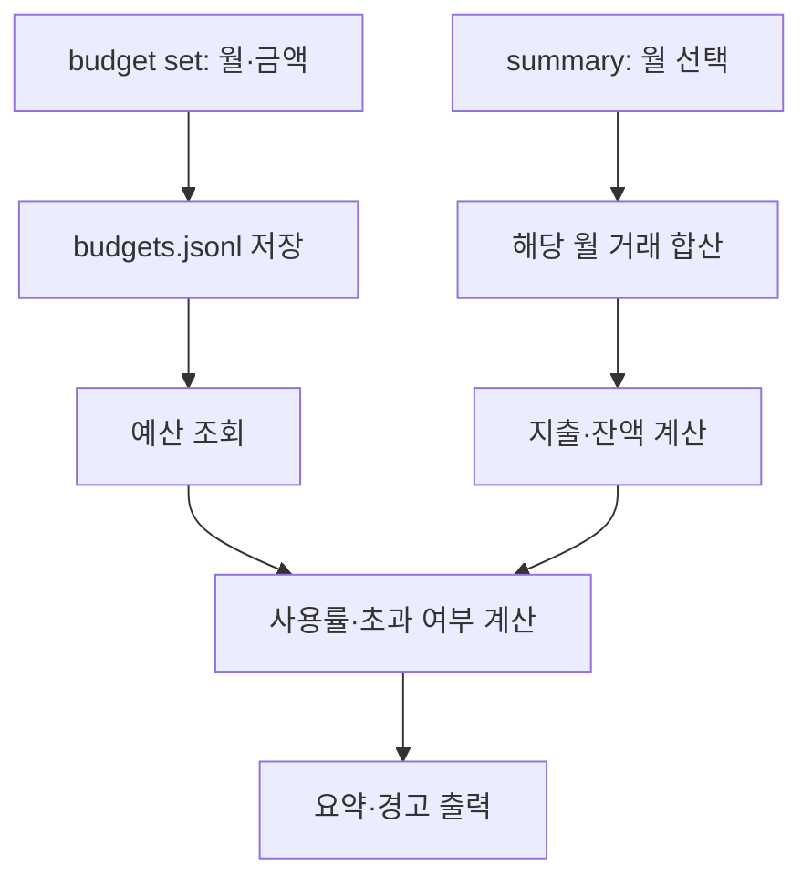

**도식 해설:** 총수입과 총지출은 따로 합산하고 잔액은 차이로 구한다. 분모인 예산은 양수만 허용하므로 0으로 나누는 오류를 피한다.

**내 구현 코드:** `service.py:set_budget,summary`; `cli.py:main(summary/budget)`. 위 경로의 함수명을 열고 입력값·반환값·실패 분기를 직접 보여주는 것이 답변의 근거다.

**VERIFY(시연·검증):** 예산 3,000원과 총지출 3,500원인 **기존 가상 검증**에서 사용률 116.67%, 초과 경고를 확인했다. 다른 월의 예산과 재시작 지속 여부도 확인한다. 참고 증빙은 `../05-tests/WSL2-INDEPENDENT-VERIFICATION.md`와 `../06-evidence/WSL2-RUNTIME-2026-10-30.md`다. **답변 작성 자체는 신규 PASS가 아니다.**

**LIMITATION(한계·대안):** 통화와 월 단위만 지원하며 일별·연간 예산의 자동 배분은 없다.

**10초 답변:** “월 지출을 예산으로 나눠 사용률을 계산하고 초과하면 경고합니다.”

**30초 답변 예시:** “월별 예산을 저장하고 요약 시 `총지출 / 월예산 × 100`으로 사용률을 계산하며 초과 시 경고한다. 거래 목록만으로는 지출이 계획을 초과했는지 즉시 알기 어렵기 때문이다.”

**1분 답변 구성:** ① 무엇을 만들었는가 — 월별 예산을 저장하고 요약 시 `총지출 / 월예산 × 100`으로 사용률을 계산하며 초과 시 경고한다. ② 왜 이 방법인가 — 거래 목록만으로는 지출이 계획을 초과했는지 즉시 알기 어렵기 때문이다. ③ 실제 코드는 — `service.py:set_budget,summary`; `cli.py:main(summary/budget)` ④ 어떻게 확인하는가 — 예산 3,000원과 총지출 3,500원인 **기존 가상 검증**에서 사용률 116.67%, 초과 경고를 확인했다. 다른 월의 예산과 재시작 지속 여부도 확인한다. ⑤ 한계는 — 통화와 월 단위만 지원하며 일별·연간 예산의 자동 배분은 없다. 이 순서로 본인 말로 설명하고 해당 함수를 열어 보여준다.

**예상 추가 질문(공식 확정 문항 아님):** 월에 거래가 없거나 예산을 등록하지 않았다면 어떤 값을 보여 주나요?

---
### E1-05. CSV 가져오기·내보내기 스키마

**기존 평가 질문:** `import/export`가 명시된 CSV 스키마로 동작하는가? (UTF-8, 헤더, 컬럼)

**평가자가 확인하려는 것:** 외부 파일 교환 시 열 구조·문자 인코딩·날짜와 금액 검증이 일치하는지 확인한다.

**핵심 용어:** 쉼표 구분 값(Comma-Separated Values, CSV), 유니코드 변환 형식(Unicode Transformation Format 8-bit, UTF-8)

**모범 답변 — WHAT(무엇):** CSV 열은 `date,type,category,amount,memo,tags` 순서이며 UTF-8과 헤더를 사용한다.

**WHY(왜 이 설계인가):** 데이터 교환 규칙을 고정하지 않으면 잘못된 열 매핑으로 지출액과 카테고리가 뒤바뀔 수 있다.

**HOW(코드가 실제로 움직이는 방식):** `CSV_FIELDS`를 `csv.DictReader`와 `DictWriter`에 공통 사용한다. import는 행별 `make_transaction()` 검증, export는 월 또는 날짜 범위 필수·내부 데이터 파일 덮어쓰기 금지·기본 기존 출력 파일 보호 정책을 둔다.

**Mermaid 구조도 / 흐름도**


**도식 해설:** 내부 저장용 JSONL과 외부 교환용 CSV는 용도가 다르다. 태그의 쉼표는 CSV 인용 처리로 한 칸에 기록하고 가져올 때 다시 목록으로 변환한다.

**내 구현 코드:** `service.py:CSV_FIELDS,import_csv,export_csv`; `cli.py:--from,--out,--month,--overwrite`. 위 경로의 함수명을 열고 입력값·반환값·실패 분기를 직접 보여주는 것이 답변의 근거다.

**VERIFY(시연·검증):** 헤더 6개, 한글 메모, 쉼표가 들어간 태그, 월/기간 필터, 잘못된 헤더, 이미 존재하는 출력 파일을 시험한다. 참고 증빙은 `../05-tests/WSL2-INDEPENDENT-VERIFICATION.md`와 `../06-evidence/WSL2-RUNTIME-2026-10-30.md`다. **답변 작성 자체는 신규 PASS가 아니다.**

**LIMITATION(한계·대안):** `utf-8-sig` 읽기를 허용해 BOM 입력을 처리하지만, 내보내기는 일반 UTF-8이며 깨진 CSV 행은 자동 복구하지 않는다.

**10초 답변:** “6개 고정 열과 UTF-8 규칙으로 CSV를 읽고 쓰며, 각 행의 값도 검증합니다.”

**30초 답변 예시:** “CSV 열은 `date,type,category,amount,memo,tags` 순서이며 UTF-8과 헤더를 사용한다. 데이터 교환 규칙을 고정하지 않으면 잘못된 열 매핑으로 지출액과 카테고리가 뒤바뀔 수 있다.”

**1분 답변 구성:** ① 무엇을 만들었는가 — CSV 열은 `date,type,category,amount,memo,tags` 순서이며 UTF-8과 헤더를 사용한다. ② 왜 이 방법인가 — 데이터 교환 규칙을 고정하지 않으면 잘못된 열 매핑으로 지출액과 카테고리가 뒤바뀔 수 있다. ③ 실제 코드는 — `service.py:CSV_FIELDS,import_csv,export_csv`; `cli.py:--from,--out,--month,--overwrite` ④ 어떻게 확인하는가 — 헤더 6개, 한글 메모, 쉼표가 들어간 태그, 월/기간 필터, 잘못된 헤더, 이미 존재하는 출력 파일을 시험한다. ⑤ 한계는 — `utf-8-sig` 읽기를 허용해 BOM 입력을 처리하지만, 내보내기는 일반 UTF-8이며 깨진 CSV 행은 자동 복구하지 않는다. 이 순서로 본인 말로 설명하고 해당 함수를 열어 보여준다.

**예상 추가 질문(공식 확정 문항 아님):** 태그에 쉼표가 들어가면 CSV 한 칸을 어떻게 안전하게 보존하나요?

---
### E1-06. 잘못된 입력과 파일 오류 안내

**기존 평가 질문:** 잘못된 입력이나 파일 오류가 발생했을 때 스택트레이스 없이 오류 메시지와 해결 힌트를 출력하는가?

**평가자가 확인하려는 것:** 사용자가 프로그래밍 내부 예외를 몰라도 문제를 수정할 수 있는지 확인한다.

**핵심 용어:** 예외 처리(Exception Handling), 스택 추적(Stack Trace), 사용자 안내(User Feedback)

**모범 답변 — WHAT(무엇):** 날짜·금액·유형·분류·파일 형식·권한 오류의 원인과 해결 힌트를 사용자에게 알려준다.

**WHY(왜 이 설계인가):** 원시 traceback은 일반 사용자에게 이해하기 어렵고, 저장 실패가 데이터 손상으로 이어지지 않게 통제해야 한다.

**HOW(코드가 실제로 움직이는 방식):** 모델 검증 함수와 서비스가 `BudgetError(reason,hint)`를 발생시키고 `@safe_cli`가 이를 가로채 `[오류]`와 `[힌트]`를 표준 오류 출력으로 제공한다. EOF·Ctrl-C·파일 I/O 일부도 별도로 처리한다.

**Mermaid 구조도 / 흐름도**

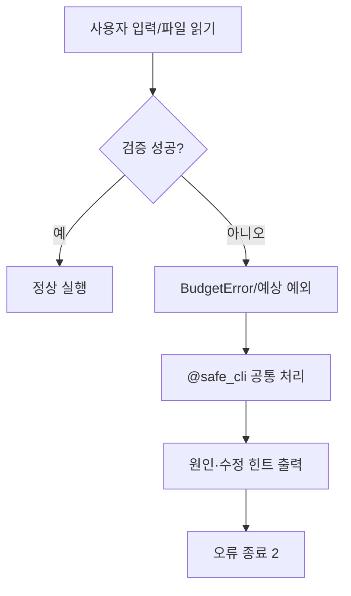

**도식 해설:** 오류의 발생 장소는 모델·서비스이지만, 출력 형식과 종료 정책은 CLI 경계에서 통일한다. 개발 오류까지 무조건 숨기는 포괄적인 `except Exception`은 사용하지 않는다.

**내 구현 코드:** `models.py:BudgetError,validate_date,validate_type,validate_amount`; `cli.py:safe_cli,HelpfulParser`. 위 경로의 함수명을 열고 입력값·반환값·실패 분기를 직접 보여주는 것이 답변의 근거다.

**VERIFY(시연·검증):** 불가능한 날짜, 금액 0, 없는 카테고리, 손상 JSONL, 없는 CSV, 키보드 입력 중단을 각각 시험해 traceback 부재를 검사한다. 참고 증빙은 `../05-tests/WSL2-INDEPENDENT-VERIFICATION.md`와 `../06-evidence/WSL2-RUNTIME-2026-10-30.md`다. **답변 작성 자체는 신규 PASS가 아니다.**

**LIMITATION(한계·대안):** 예상하지 못한 프로그래밍 결함은 개발 진단이 필요하므로 모든 예외를 일괄적으로 성공 처리하지 않는다.

**10초 답변:** “예상 가능한 오류는 원인과 해결 힌트를 출력하고 traceback 없이 종료합니다.”

**30초 답변 예시:** “날짜·금액·유형·분류·파일 형식·권한 오류의 원인과 해결 힌트를 사용자에게 알려준다. 원시 traceback은 일반 사용자에게 이해하기 어렵고, 저장 실패가 데이터 손상으로 이어지지 않게 통제해야 한다.”

**1분 답변 구성:** ① 무엇을 만들었는가 — 날짜·금액·유형·분류·파일 형식·권한 오류의 원인과 해결 힌트를 사용자에게 알려준다. ② 왜 이 방법인가 — 원시 traceback은 일반 사용자에게 이해하기 어렵고, 저장 실패가 데이터 손상으로 이어지지 않게 통제해야 한다. ③ 실제 코드는 — `models.py:BudgetError,validate_date,validate_type,validate_amount`; `cli.py:safe_cli,HelpfulParser` ④ 어떻게 확인하는가 — 불가능한 날짜, 금액 0, 없는 카테고리, 손상 JSONL, 없는 CSV, 키보드 입력 중단을 각각 시험해 traceback 부재를 검사한다. ⑤ 한계는 — 예상하지 못한 프로그래밍 결함은 개발 진단이 필요하므로 모든 예외를 일괄적으로 성공 처리하지 않는다. 이 순서로 본인 말로 설명하고 해당 함수를 열어 보여준다.

**예상 추가 질문(공식 확정 문항 아님):** 모든 Exception을 한꺼번에 잡는 방식은 왜 조심해야 하나요?

---
### E1-07. 정상·오류 종료 코드

**기존 평가 질문:** 오류 상황에서 종료 코드가 `0`이 아님을 확인할 수 있는가?

**평가자가 확인하려는 것:** 사람뿐 아니라 자동화 스크립트도 명령 성공·실패를 구분할 수 있는지 확인한다.

**핵심 용어:** 종료 코드(Exit Code), 표준 오류(Standard Error, stderr)

**모범 답변 — WHAT(무엇):** 정상 명령은 종료 코드 0, 처리된 사용자 오류는 2, 일부 잘못된 명령 인자도 argparse에 의해 2로 종료된다.

**WHY(왜 이 설계인가):** 오류에도 0을 반환하면 호출한 자동화가 실패를 성공으로 오해하기 때문이다.

**HOW(코드가 실제로 움직이는 방식):** `main()`은 성공 시 0을 반환하고 `safe_cli()`는 처리된 오류 시 2를 반환한다. 부분 성공 import도 정상 행을 저장하지만 건너뛴 행이 있으면 2를 반환한다. 실제 프로세스 종료는 `__main__.py`에서 연결된다.

**Mermaid 구조도 / 흐름도**

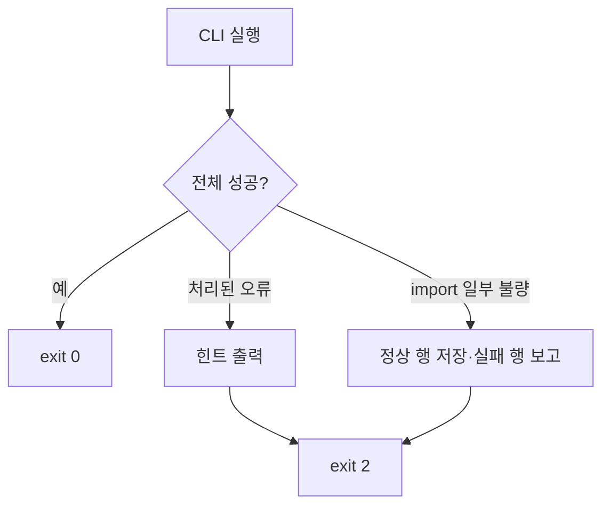

**도식 해설:** import 일부 성공은 데이터 반영 사실을 감추지 않으면서 상위 자동화에는 불완전한 성공을 알리는 정책이다.

**내 구현 코드:** `cli.py:safe_cli,main`; `__main__.py`; `service.py:import_csv`. 위 경로의 함수명을 열고 입력값·반환값·실패 분기를 직접 보여주는 것이 답변의 근거다.

**VERIFY(시연·검증):** 임시 데이터 폴더에서 정상 `category list` 후 `echo $?`, 존재하지 않는 ID로 delete 후 `echo $?`를 실행한다. 두 실행 직후 각각 별도로 확인해야 한다. 참고 증빙은 `../05-tests/WSL2-INDEPENDENT-VERIFICATION.md`와 `../06-evidence/WSL2-RUNTIME-2026-10-30.md`다. **답변 작성 자체는 신규 PASS가 아니다.**

**LIMITATION(한계·대안):** 종료 코드 숫자 2는 이 구현의 선택이며 모든 프로그램이 같은 오류 번호를 써야 하는 규칙은 아니다.

**10초 답변:** “정상은 0, 오류와 불완전한 가져오기는 2로 알려 자동화가 실패를 감지하게 합니다.”

**30초 답변 예시:** “정상 명령은 종료 코드 0, 처리된 사용자 오류는 2, 일부 잘못된 명령 인자도 argparse에 의해 2로 종료된다. 오류에도 0을 반환하면 호출한 자동화가 실패를 성공으로 오해하기 때문이다.”

**1분 답변 구성:** ① 무엇을 만들었는가 — 정상 명령은 종료 코드 0, 처리된 사용자 오류는 2, 일부 잘못된 명령 인자도 argparse에 의해 2로 종료된다. ② 왜 이 방법인가 — 오류에도 0을 반환하면 호출한 자동화가 실패를 성공으로 오해하기 때문이다. ③ 실제 코드는 — `cli.py:safe_cli,main`; `__main__.py`; `service.py:import_csv` ④ 어떻게 확인하는가 — 임시 데이터 폴더에서 정상 `category list` 후 `echo $?`, 존재하지 않는 ID로 delete 후 `echo $?`를 실행한다. 두 실행 직후 각각 별도로 확인해야 한다. ⑤ 한계는 — 종료 코드 숫자 2는 이 구현의 선택이며 모든 프로그램이 같은 오류 번호를 써야 하는 규칙은 아니다. 이 순서로 본인 말로 설명하고 해당 함수를 열어 보여준다.

**예상 추가 질문(공식 확정 문항 아님):** CSV에서 정상 2행·오류 1행이면 파일 저장과 종료 상태는 각각 무엇인가요?

---
### E2-01. 모듈 최소 3개와 책임 분리

**기존 평가 질문:** 코드가 3개 이상 모듈로 분리되어 있고, 각 모듈의 책임을 어떻게 나눴는지 설명할 수 있는가?

**평가자가 확인하려는 것:** 입력·규칙·저장을 한 파일에 혼합하지 않은 설계 목적을 설명할 수 있는지 확인한다.

**핵심 용어:** 모듈(Module), 관심사 분리(Separation of Concerns, SoC), 파일 입출력(Input/Output, I/O)

**모범 답변 — WHAT(무엇):** `cli.py`, `service.py`, `storage.py`, `models.py`로 역할을 분리했다.

**WHY(왜 이 설계인가):** 입력 형식이 바뀌어도 핵심 계산을 덜 수정하고, 저장 매체가 바뀌어도 CLI를 재사용하기 쉽기 때문이다.

**HOW(코드가 실제로 움직이는 방식):** CLI는 명령·화면과 오류 안내, Service는 거래·분류·예산 규칙, Store는 JSONL 파일 I/O, Models는 타입과 데이터 검증을 담당한다. `__main__.py`는 실행 진입점이다.

**Mermaid 구조도 / 흐름도**

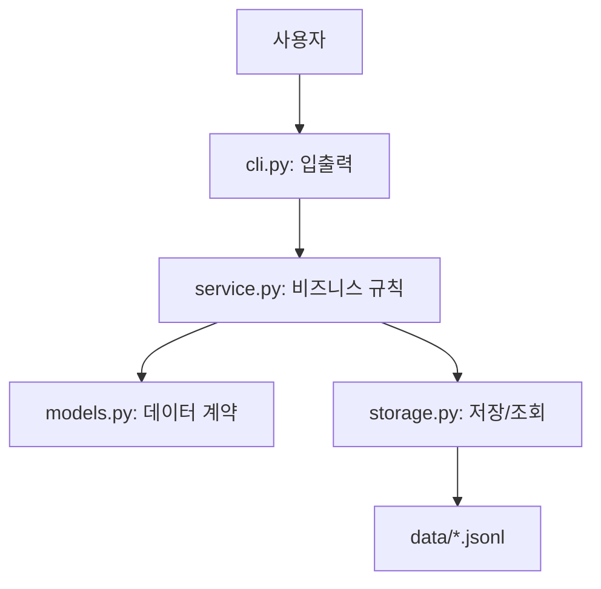

**도식 해설:** 화면·명령을 모르는 모델과 파일 저장 방식에 덜 종속된 서비스라는 경계를 설명할 수 있어야 한다. `BudgetService`가 Store를 조합하는 형태다.

**내 구현 코드:** `04-src/budget_app/cli.py`, `service.py`, `storage.py`, `models.py`, `__main__.py`. 위 경로의 함수명을 열고 입력값·반환값·실패 분기를 직접 보여주는 것이 답변의 근거다.

**VERIFY(시연·검증):** 각 파일의 import·클래스·함수를 열어 역할을 설명하고, `04-src`에서 `python3 -m budget_app --help`가 실행되는지 확인한다. 참고 증빙은 `../05-tests/WSL2-INDEPENDENT-VERIFICATION.md`와 `../06-evidence/WSL2-RUNTIME-2026-10-30.md`다. **답변 작성 자체는 신규 PASS가 아니다.**

**LIMITATION(한계·대안):** 대규모 프로젝트의 플러그인/추상 인터페이스까지 도입한 것은 아니며 미션 최소 구조에 맞춘 설계다.

**10초 답변:** “CLI·서비스·저장소·모델을 나눠 변경과 테스트를 쉽게 했습니다.”

**30초 답변 예시:** “`cli.py`, `service.py`, `storage.py`, `models.py`로 역할을 분리했다. 입력 형식이 바뀌어도 핵심 계산을 덜 수정하고, 저장 매체가 바뀌어도 CLI를 재사용하기 쉽기 때문이다.”

**1분 답변 구성:** ① 무엇을 만들었는가 — `cli.py`, `service.py`, `storage.py`, `models.py`로 역할을 분리했다. ② 왜 이 방법인가 — 입력 형식이 바뀌어도 핵심 계산을 덜 수정하고, 저장 매체가 바뀌어도 CLI를 재사용하기 쉽기 때문이다. ③ 실제 코드는 — `04-src/budget_app/cli.py`, `service.py`, `storage.py`, `models.py`, `__main__.py` ④ 어떻게 확인하는가 — 각 파일의 import·클래스·함수를 열어 역할을 설명하고, `04-src`에서 `python3 -m budget_app --help`가 실행되는지 확인한다. ⑤ 한계는 — 대규모 프로젝트의 플러그인/추상 인터페이스까지 도입한 것은 아니며 미션 최소 구조에 맞춘 설계다. 이 순서로 본인 말로 설명하고 해당 함수를 열어 보여준다.

**예상 추가 질문(공식 확정 문항 아님):** 파일 저장 방식을 SQLite로 바꾼다면 어느 계층을 우선 수정해야 하나요?

---
### E2-02. 2개 이상 클래스의 책임 경계

**기존 평가 질문:** 최소 2개 이상의 클래스에 부여한 책임 경계를 어떻게 정했는지 설명할 수 있는가?

**평가자가 확인하려는 것:** 클래스를 단지 개수만 채운 게 아니라 응집도 높은 책임으로 구성했는지 확인한다.

**핵심 용어:** 데이터 클래스(Data Class, dataclass), 캡슐화(Encapsulation), 단일 책임 원칙(Single Responsibility Principle, SRP)

**모범 답변 — WHAT(무엇):** `Transaction`은 거래 데이터, `BudgetService`는 업무 규칙, `Store`는 파일 저장 책임이다. 추가로 `BudgetError`는 오류 계약, `HelpfulParser`는 CLI 문법 오류 안내를 담당한다.

**WHY(왜 이 설계인가):** 데이터 정의와 처리 절차를 분리하면 한 변경이 다른 계층에 미치는 영향을 줄일 수 있다.

**HOW(코드가 실제로 움직이는 방식):** `Transaction`은 `@dataclass(frozen=True)`로 필드를 명시하고 직렬화·복원을 담당하며, `BudgetService`는 거래 유효성·중복 분류·예산 계산, `Store`는 파일 생성·스트리밍·교체를 담당한다.

**Mermaid 구조도 / 흐름도**

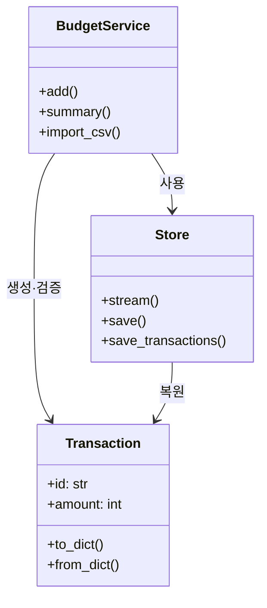

**도식 해설:** 클래스 간 화살표는 서비스가 저장소와 모델을 이용한다는 의미이지 상속 관계가 아니다. 비즈니스 변경과 파일 포맷 변경이 각각 다른 클래스에 집중된다.

**내 구현 코드:** `models.py:Transaction,BudgetError`; `service.py:BudgetService`; `storage.py:Store`; `cli.py:HelpfulParser`. 위 경로의 함수명을 열고 입력값·반환값·실패 분기를 직접 보여주는 것이 답변의 근거다.

**VERIFY(시연·검증):** `Transaction` 필드의 유효성, `BudgetService.summary()`의 계산, `Store.save()`의 파일 교체를 각각 코드로 설명한다. 참고 증빙은 `../05-tests/WSL2-INDEPENDENT-VERIFICATION.md`와 `../06-evidence/WSL2-RUNTIME-2026-10-30.md`다. **답변 작성 자체는 신규 PASS가 아니다.**

**LIMITATION(한계·대안):** 현재 서비스는 파일 저장소 구현에 직접 결합돼 있으므로, 여러 저장소를 교환하는 추상화는 추가 작업이 필요하다.

**10초 답변:** “Transaction은 데이터, BudgetService는 규칙, Store는 파일 저장을 맡습니다.”

**30초 답변 예시:** “`Transaction`은 거래 데이터, `BudgetService`는 업무 규칙, `Store`는 파일 저장 책임이다. 추가로 `BudgetError`는 오류 계약, `HelpfulParser`는 CLI 문법 오류 안내를 담당한다. 데이터 정의와 처리 절차를 분리하면 한 변경이 다른 계층에 미치는 영향을 줄일 수 있다.”

**1분 답변 구성:** ① 무엇을 만들었는가 — `Transaction`은 거래 데이터, `BudgetService`는 업무 규칙, `Store`는 파일 저장 책임이다. 추가로 `BudgetError`는 오류 계약, `HelpfulParser`는 CLI 문법 오류 안내를 담당한다. ② 왜 이 방법인가 — 데이터 정의와 처리 절차를 분리하면 한 변경이 다른 계층에 미치는 영향을 줄일 수 있다. ③ 실제 코드는 — `models.py:Transaction,BudgetError`; `service.py:BudgetService`; `storage.py:Store`; `cli.py:HelpfulParser` ④ 어떻게 확인하는가 — `Transaction` 필드의 유효성, `BudgetService.summary()`의 계산, `Store.save()`의 파일 교체를 각각 코드로 설명한다. ⑤ 한계는 — 현재 서비스는 파일 저장소 구현에 직접 결합돼 있으므로, 여러 저장소를 교환하는 추상화는 추가 작업이 필요하다. 이 순서로 본인 말로 설명하고 해당 함수를 열어 보여준다.

**예상 추가 질문(공식 확정 문항 아님):** Transaction을 단순 dict 대신 dataclass로 정의한 장점은 무엇인가요?

---
### E2-03. update/delete 파일 안전성

**기존 평가 질문:** 파일 기반 `update/delete`를 어떻게 안전하게 처리했는지 설명할 수 있는가?

**평가자가 확인하려는 것:** 수정 도중 실패해도 기존 파일을 가능한 한 보존할 수 있는 저장 전략을 설명한다.

**핵심 용어:** 원자적 교체(Atomic Replacement), 임시 파일(Temporary File), 동기화(fsync)

**모범 답변 — WHAT(무엇):** 수정·삭제 시 기존 목록을 검증·재구성한 후 동일 디렉터리의 임시 파일에 쓰고 `os.replace()`로 원본 경로를 바꾼다.

**WHY(왜 이 설계인가):** 원본을 직접 열고 중간에 쓰기를 실패하면 데이터가 절반만 기록될 수 있다.

**HOW(코드가 실제로 움직이는 방식):** `update/delete`가 새 목록을 만들고 `Store.save_transactions()`가 날짜순 정렬한 뒤 `Store.save()`의 `NamedTemporaryFile→flush→fsync→os.replace`를 수행한다. finally에서 임시 파일 정리를 시도한다.

**Mermaid 구조도 / 흐름도**

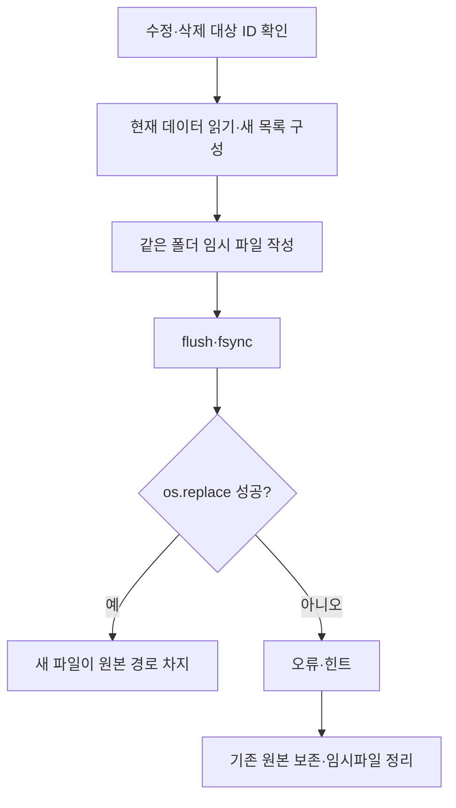

**도식 해설:** `os.replace()`는 같은 파일시스템 내 대상 경로 교체에 유리하다. 다만 전원 중단 내구성, 폴더 fsync, 여러 파일 일괄 갱신, 동시 쓰기 경쟁까지 모두 해결했다는 뜻은 아니다.

**내 구현 코드:** `service.py:update,delete`; `storage.py:save_transactions,save`. 위 경로의 함수명을 열고 입력값·반환값·실패 분기를 직접 보여주는 것이 답변의 근거다.

**VERIFY(시연·검증):** 기존 단위 테스트의 `os.replace` 실패 주입에서 수정 전 거래 파일 바이트가 유지되는지 확인한 기록이 있다. 실제 물리적 전원 차단은 미실험이다. 참고 증빙은 `../05-tests/WSL2-INDEPENDENT-VERIFICATION.md`와 `../06-evidence/WSL2-RUNTIME-2026-10-30.md`다. **답변 작성 자체는 신규 PASS가 아니다.**

**LIMITATION(한계·대안):** 거래 전체 재작성으로 데이터 양에 비례해 쓰기 비용이 커지며 다중 프로세스 동시 수정은 보호하지 않는다.

**10초 답변:** “임시 파일을 완성한 뒤 원본 파일을 교체하여 중간 실패 시 기존 데이터를 보호합니다.”

**30초 답변 예시:** “수정·삭제 시 기존 목록을 검증·재구성한 후 동일 디렉터리의 임시 파일에 쓰고 `os.replace()`로 원본 경로를 바꾼다. 원본을 직접 열고 중간에 쓰기를 실패하면 데이터가 절반만 기록될 수 있다.”

**1분 답변 구성:** ① 무엇을 만들었는가 — 수정·삭제 시 기존 목록을 검증·재구성한 후 동일 디렉터리의 임시 파일에 쓰고 `os.replace()`로 원본 경로를 바꾼다. ② 왜 이 방법인가 — 원본을 직접 열고 중간에 쓰기를 실패하면 데이터가 절반만 기록될 수 있다. ③ 실제 코드는 — `service.py:update,delete`; `storage.py:save_transactions,save` ④ 어떻게 확인하는가 — 기존 단위 테스트의 `os.replace` 실패 주입에서 수정 전 거래 파일 바이트가 유지되는지 확인한 기록이 있다. 실제 물리적 전원 차단은 미실험이다. ⑤ 한계는 — 거래 전체 재작성으로 데이터 양에 비례해 쓰기 비용이 커지며 다중 프로세스 동시 수정은 보호하지 않는다. 이 순서로 본인 말로 설명하고 해당 함수를 열어 보여준다.

**예상 추가 질문(공식 확정 문항 아님):** 원자적 교체와 데이터베이스의 ACID 트랜잭션은 같은 개념인가요?

---
### E3-01. yield 기반 제너레이터 스트리밍

**기존 평가 질문:** `list/search`를 제너레이터로 스트리밍 처리한 방식을 어떻게 구현했고 왜 유리한지 설명할 수 있는가?

**평가자가 확인하려는 것:** 한 번에 전체 파일을 읽지 않는 지연 평가의 효과와 실제 한계를 이해하는지 확인한다.

**핵심 용어:** 제너레이터(Generator), 지연 평가(Lazy Evaluation), 스트리밍(Streaming)

**모범 답변 — WHAT(무엇):** `Store.stream()`과 `transaction_stream()`이 파일을 한 줄씩 `yield`하고, `BudgetService.list/search`도 하나씩 반환한다.

**WHY(왜 이 설계인가):** 전체 데이터를 리스트로 만들지 않아도 순차 조회할 수 있어 조회 순간의 추가 메모리 사용을 줄인다.

**HOW(코드가 실제로 움직이는 방식):** `stream()`은 JSONL 줄을 JSON으로 변환하여 넘기고, `transaction_stream()`이 `Transaction` 객체로 복원한다. `list()`는 `--limit`만큼 반환하고 `search()`는 여러 조건을 만족하는 항목만 `yield`한다. 최신순은 저장 단계의 날짜 내림차순 정렬로 보장한다.

**Mermaid 구조도 / 흐름도**

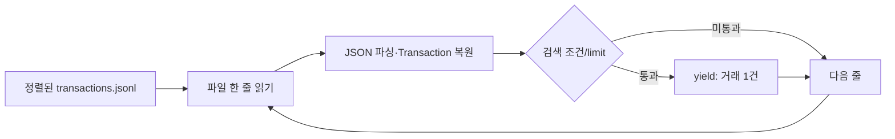

**도식 해설:** `yield`가 실행 상태를 기억하므로 다음 항목 요청 시 중단 지점부터 진행한다. 다만 현재 add/update/delete는 전체 데이터를 리스트로 읽는 별도 경로이므로 앱 전체가 무조건 O(1) 메모리인 것은 아니다.

**내 구현 코드:** `storage.py:stream,transaction_stream,save_transactions`; `service.py:list,search`. 위 경로의 함수명을 열고 입력값·반환값·실패 분기를 직접 보여주는 것이 답변의 근거다.

**VERIFY(시연·검증):** 제너레이터 객체 여부 검사와 최신순/필터 동작은 기존 29개 단위시험·61회 CLI 기록에 포함된다. 큰 파일의 실제 최대 메모리는 별도 측정이 필요하다. 참고 증빙은 `../05-tests/WSL2-INDEPENDENT-VERIFICATION.md`와 `../06-evidence/WSL2-RUNTIME-2026-10-30.md`다. **답변 작성 자체는 신규 PASS가 아니다.**

**LIMITATION(한계·대안):** 최신순 유지를 위한 저장 시 전체 정렬은 메모리 O(n), 정렬 O(n log n)이며 list/search 자체는 파일 순회 O(n)가 될 수 있다.

**10초 답변:** “조회는 yield로 한 줄씩 넘겨 메모리 사용을 줄이고, 최신순은 저장 시 정렬해 보장합니다.”

**30초 답변 예시:** “`Store.stream()`과 `transaction_stream()`이 파일을 한 줄씩 `yield`하고, `BudgetService.list/search`도 하나씩 반환한다. 전체 데이터를 리스트로 만들지 않아도 순차 조회할 수 있어 조회 순간의 추가 메모리 사용을 줄인다.”

**1분 답변 구성:** ① 무엇을 만들었는가 — `Store.stream()`과 `transaction_stream()`이 파일을 한 줄씩 `yield`하고, `BudgetService.list/search`도 하나씩 반환한다. ② 왜 이 방법인가 — 전체 데이터를 리스트로 만들지 않아도 순차 조회할 수 있어 조회 순간의 추가 메모리 사용을 줄인다. ③ 실제 코드는 — `storage.py:stream,transaction_stream,save_transactions`; `service.py:list,search` ④ 어떻게 확인하는가 — 제너레이터 객체 여부 검사와 최신순/필터 동작은 기존 29개 단위시험·61회 CLI 기록에 포함된다. 큰 파일의 실제 최대 메모리는 별도 측정이 필요하다. ⑤ 한계는 — 최신순 유지를 위한 저장 시 전체 정렬은 메모리 O(n), 정렬 O(n log n)이며 list/search 자체는 파일 순회 O(n)가 될 수 있다. 이 순서로 본인 말로 설명하고 해당 함수를 열어 보여준다.

**예상 추가 질문(공식 확정 문항 아님):** `return list(...)`와 `yield`의 메모리 차이를 예로 설명해 보세요.

---
### E3-02. 데코레이터 공통 예외 처리

**기존 평가 질문:** 데코레이터로 분리한 공통 기능이 무엇이며 왜 분리가 필요했는지 설명할 수 있는가?

**평가자가 확인하려는 것:** 다수 명령에서 반복되는 오류 처리 흐름을 함수 외부로 분리한 이유를 설명한다.

**핵심 용어:** 데코레이터(Decorator), 래퍼 함수(Wrapper Function), 공통 관심사(Cross-Cutting Concern)

**모범 답변 — WHAT(무엇):** `@safe_cli` 데코레이터가 공통 입력 중단·데이터·파일 오류 처리를 담당한다.

**WHY(왜 이 설계인가):** 여러 명령마다 동일한 try/except를 복사하면 누락·불일치 위험이 생기기 때문이다.

**HOW(코드가 실제로 움직이는 방식):** `safe_cli(func)`이 `wrapped(*args, **kwargs)`를 반환한다. `@functools.wraps(func)`로 메타데이터를 보존하고, 정상은 원래 함수 반환값을 전달, 예상 오류는 표준 출력 형식으로 변환해 2를 반환한다.

**Mermaid 구조도 / 흐름도**

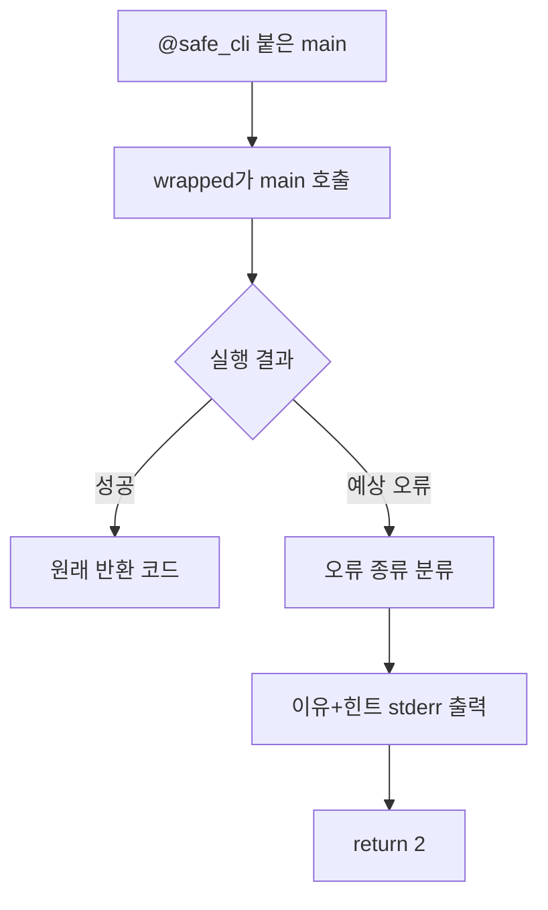

**도식 해설:** 함수의 주 목적은 명령 실행이고 데코레이터는 그 주변의 공통 오류 정책을 처리한다. 데코레이터를 제거하거나 변경하면 여러 명령의 안내가 한 곳에서 바뀐다.

**내 구현 코드:** `cli.py:safe_cli,@safe_cli main`; `models.py:BudgetError`. 위 경로의 함수명을 열고 입력값·반환값·실패 분기를 직접 보여주는 것이 답변의 근거다.

**VERIFY(시연·검증):** 오류가 발생하는 명령 여러 개에서 동일한 `[오류]`/`[힌트]` 형식을 확인한다. `safe_cli`가 실제 `main`에 적용된 코드 줄을 보여준다. 참고 증빙은 `../05-tests/WSL2-INDEPENDENT-VERIFICATION.md`와 `../06-evidence/WSL2-RUNTIME-2026-10-30.md`다. **답변 작성 자체는 신규 PASS가 아니다.**

**LIMITATION(한계·대안):** 타입 힌트 `Callable[..., int]`는 입력 인자의 세부 시그니처를 완전히 보존하는 정밀한 타입 표현은 아니다.

**10초 답변:** “@safe_cli가 여러 명령의 오류 안내·종료 코드를 한 곳에서 통일합니다.”

**30초 답변 예시:** “`@safe_cli` 데코레이터가 공통 입력 중단·데이터·파일 오류 처리를 담당한다. 여러 명령마다 동일한 try/except를 복사하면 누락·불일치 위험이 생기기 때문이다.”

**1분 답변 구성:** ① 무엇을 만들었는가 — `@safe_cli` 데코레이터가 공통 입력 중단·데이터·파일 오류 처리를 담당한다. ② 왜 이 방법인가 — 여러 명령마다 동일한 try/except를 복사하면 누락·불일치 위험이 생기기 때문이다. ③ 실제 코드는 — `cli.py:safe_cli,@safe_cli main`; `models.py:BudgetError` ④ 어떻게 확인하는가 — 오류가 발생하는 명령 여러 개에서 동일한 `[오류]`/`[힌트]` 형식을 확인한다. `safe_cli`가 실제 `main`에 적용된 코드 줄을 보여준다. ⑤ 한계는 — 타입 힌트 `Callable[..., int]`는 입력 인자의 세부 시그니처를 완전히 보존하는 정밀한 타입 표현은 아니다. 이 순서로 본인 말로 설명하고 해당 함수를 열어 보여준다.

**예상 추가 질문(공식 확정 문항 아님):** `functools.wraps`는 왜 사용하며, 데코레이터를 적용하지 않으면 어떤 중복이 생기나요?

---
### E3-03. 타입 힌트와 입력·출력 계약

**기존 평가 질문:** 타입 힌트를 적용해 얻는 이점을 실제 코드 예로 어떻게 확인했고 왜 도움이 되는지 설명할 수 있는가?

**평가자가 확인하려는 것:** 변수·반환형 계약과 런타임 검증을 구별할 수 있는지 평가한다.

**핵심 용어:** 타입 힌트(Type Hint), 입력·출력 계약(Type Contract), 정적 타입 검사(Static Type Checking)

**모범 답변 — WHAT(무엇):** `list() -> Iterator[Transaction]`, `validate_amount(value: object) -> int`, `parse_tags(value: str | list[str] | None) -> list[str]` 같은 선언을 사용했다.

**WHY(왜 이 설계인가):** 함수의 인자·반환값을 읽기 쉽게 하고 IDE 도움말·정적 분석에서 실수 가능성을 낮추기 때문이다.

**HOW(코드가 실제로 움직이는 방식):** 모델·저장소·서비스 함수 서명에 반환형을 적었으며, 실제 잘못된 값을 막는 것은 `validate_amount`, `validate_date`, `Transaction.from_dict`의 별도 런타임 검증이다.

**Mermaid 구조도 / 흐름도**

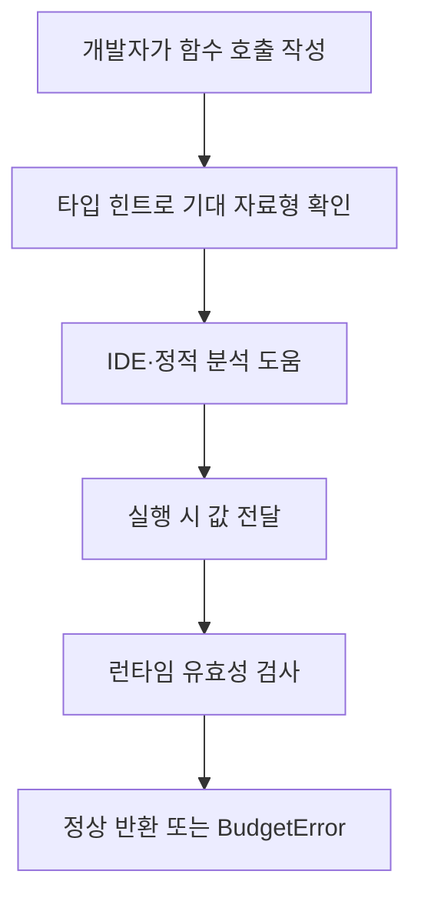

**도식 해설:** Python 타입 힌트 자체는 입력을 자동 차단하지 않는다. 문서화·개발 지원과 실제 사용자 입력 검증을 두 층으로 나눠 설명해야 한다.

**내 구현 코드:** `models.py:validate_amount,parse_tags,Transaction`; `storage.py:stream,transaction_stream`; `service.py:list,search`. 위 경로의 함수명을 열고 입력값·반환값·실패 분기를 직접 보여주는 것이 답변의 근거다.

**VERIFY(시연·검증):** 소스 시그니처와 반환 자료형을 연결해 설명한다. 기존 기록은 타입 힌트의 정적 존재 검사이며 mypy 등 정적 타입 검사기 실행 PASS는 기록되지 않았다. 참고 증빙은 `../05-tests/WSL2-INDEPENDENT-VERIFICATION.md`와 `../06-evidence/WSL2-RUNTIME-2026-10-30.md`다. **답변 작성 자체는 신규 PASS가 아니다.**

**LIMITATION(한계·대안):** 몇몇 반환형이 `dict`처럼 포괄적이므로 TypedDict 등을 도입하면 장기적으로 계약을 더 명확히 할 수 있다(필수 아님).

**10초 답변:** “타입 힌트는 개발자가 자료형 계약을 이해하게 하고, 잘못된 실제 값은 검증 함수가 막습니다.”

**30초 답변 예시:** “`list() -> Iterator[Transaction]`, `validate_amount(value: object) -> int`, `parse_tags(value: str | list[str] | None) -> list[str]` 같은 선언을 사용했다. 함수의 인자·반환값을 읽기 쉽게 하고 IDE 도움말·정적 분석에서 실수 가능성을 낮추기 때문이다.”

**1분 답변 구성:** ① 무엇을 만들었는가 — `list() -> Iterator[Transaction]`, `validate_amount(value: object) -> int`, `parse_tags(value: str | list[str] | None) -> list[str]` 같은 선언을 사용했다. ② 왜 이 방법인가 — 함수의 인자·반환값을 읽기 쉽게 하고 IDE 도움말·정적 분석에서 실수 가능성을 낮추기 때문이다. ③ 실제 코드는 — `models.py:validate_amount,parse_tags,Transaction`; `storage.py:stream,transaction_stream`; `service.py:list,search` ④ 어떻게 확인하는가 — 소스 시그니처와 반환 자료형을 연결해 설명한다. 기존 기록은 타입 힌트의 정적 존재 검사이며 mypy 등 정적 타입 검사기 실행 PASS는 기록되지 않았다. ⑤ 한계는 — 몇몇 반환형이 `dict`처럼 포괄적이므로 TypedDict 등을 도입하면 장기적으로 계약을 더 명확히 할 수 있다(필수 아님). 이 순서로 본인 말로 설명하고 해당 함수를 열어 보여준다.

**예상 추가 질문(공식 확정 문항 아님):** 타입 힌트가 `int`이면 문자열 숫자가 런타임에서 자동으로 거절되나요?

---
### E4-01. 내부 JSONL과 CSV 선택 근거

**기존 평가 질문:** JSONL과 CSV 중 선택한 저장 포맷의 장단점을 비교하고 왜 그 포맷을 택했는지 근거를 말할 수 있는가?

**평가자가 확인하려는 것:** 자료 구조와 외부 교환 요구에 맞는 저장 형식 선택의 타당성을 설명한다.

**핵심 용어:** 줄 단위 JSON(JSON Lines, JSONL), 쉼표 구분 값(Comma-Separated Values, CSV), 직렬화(Serialization)

**모범 답변 — WHAT(무엇):** 내부 영속 저장은 JSONL을, 외부 가져오기·내보내기는 CSV를 사용한다.

**WHY(왜 이 설계인가):** JSONL은 거래의 문자열·숫자·태그 리스트 구조를 자연스럽게 표현하고, CSV는 스프레드시트와 교환하기 편하다.

**HOW(코드가 실제로 움직이는 방식):** 내부 파일은 `json.dumps`로 한 줄 한 객체를 쓰고 `json.loads`로 복원한다. 외부 CSV는 `csv.DictReader/DictWriter`로 고정 열의 행을 입출력한다.

**Mermaid 구조도 / 흐름도**


**도식 해설:** CSV는 열 이름과 값이 단순해 범용성이 좋지만 목록형 태그나 자료형 복원이 추가 규칙을 요구한다. JSONL은 유연한 대신 인덱스·동시 수정·대규모 집계에 불리하다.

**내 구현 코드:** `storage.py:stream,save`; `service.py:CSV_FIELDS,import_csv,export_csv`; `models.py:Transaction`. 위 경로의 함수명을 열고 입력값·반환값·실패 분기를 직접 보여주는 것이 답변의 근거다.

**VERIFY(시연·검증):** 거래의 tags가 JSONL에서는 리스트로, CSV에서는 쉼표 결합 문자열로 나타나는지 실제 출력과 코드로 비교한다. 참고 증빙은 `../05-tests/WSL2-INDEPENDENT-VERIFICATION.md`와 `../06-evidence/WSL2-RUNTIME-2026-10-30.md`다. **답변 작성 자체는 신규 PASS가 아니다.**

**LIMITATION(한계·대안):** JSONL은 관계형 제약·동시 쓰기·빠른 임의 갱신을 제공하지 않아 규모 확대 시 DB 전환을 고려한다.

**10초 답변:** “내부는 태그 구조를 보존하기 쉬운 JSONL, 외부 교환은 범용 CSV를 사용합니다.”

**30초 답변 예시:** “내부 영속 저장은 JSONL을, 외부 가져오기·내보내기는 CSV를 사용한다. JSONL은 거래의 문자열·숫자·태그 리스트 구조를 자연스럽게 표현하고, CSV는 스프레드시트와 교환하기 편하다.”

**1분 답변 구성:** ① 무엇을 만들었는가 — 내부 영속 저장은 JSONL을, 외부 가져오기·내보내기는 CSV를 사용한다. ② 왜 이 방법인가 — JSONL은 거래의 문자열·숫자·태그 리스트 구조를 자연스럽게 표현하고, CSV는 스프레드시트와 교환하기 편하다. ③ 실제 코드는 — `storage.py:stream,save`; `service.py:CSV_FIELDS,import_csv,export_csv`; `models.py:Transaction` ④ 어떻게 확인하는가 — 거래의 tags가 JSONL에서는 리스트로, CSV에서는 쉼표 결합 문자열로 나타나는지 실제 출력과 코드로 비교한다. ⑤ 한계는 — JSONL은 관계형 제약·동시 쓰기·빠른 임의 갱신을 제공하지 않아 규모 확대 시 DB 전환을 고려한다. 이 순서로 본인 말로 설명하고 해당 함수를 열어 보여준다.

**예상 추가 질문(공식 확정 문항 아님):** 태그와 숫자를 저장할 때 JSONL·CSV의 차이는 무엇인가요?

---
### E4-02. 10만 건 데이터 병목과 개선

**기존 평가 질문:** 거래가 10만 건으로 늘어난다면 현재 구조의 병목이 어디이며 어떻게 개선할지 설명할 수 있는가?

**평가자가 확인하려는 것:** 구현의 알고리즘 비용과 확장 시 개선 우선순위를 근거로 설명한다.

**핵심 용어:** 시간 복잡도(Time Complexity), 선형 탐색(Linear Scan), 데이터베이스 색인(Database Index)

**모범 답변 — WHAT(무엇):** 읽기 메모리는 스트리밍으로 절약하지만, 추가·수정·삭제·CSV 일괄 가져오기는 전체 읽기·정렬·재작성 때문에 병목이 생긴다.

**WHY(왜 이 설계인가):** 10만 건을 매 변경마다 다시 저장하면 파일 I/O 비용과 동시 수정 손실 위험이 커지기 때문이다.

**HOW(코드가 실제로 움직이는 방식):** 현재 `transactions()`가 전체 데이터를 리스트화하고 `save_transactions()`가 정렬 O(n log n) 후 다시 쓴다. 개선은 측정→SQLite 색인과 트랜잭션 도입→파일/DB API 추상화→동시성 시험 순서로 진행한다.

**Mermaid 구조도 / 흐름도**

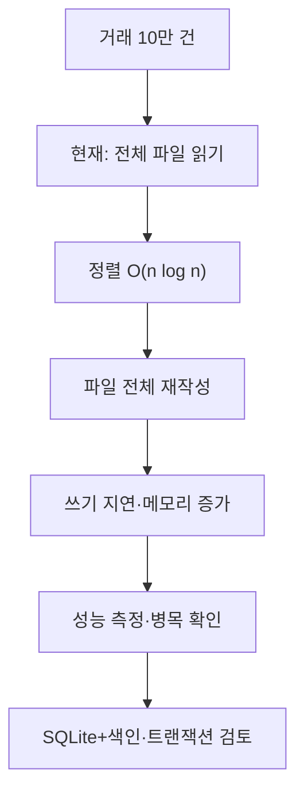

**도식 해설:** 검색은 조건에 따라 O(n) 순회를 수행하고, 저장은 정렬·재작성 비용을 동반한다. SQLite로 바꾸면 개별 행 갱신과 색인 검색이 가능하지만 쿼리 설계·마이그레이션·테스트가 필요하다.

**내 구현 코드:** `storage.py:transactions,save_transactions,save`; `service.py:add,update,delete,import_csv`. 위 경로의 함수명을 열고 입력값·반환값·실패 분기를 직접 보여주는 것이 답변의 근거다.

**VERIFY(시연·검증):** 기존에는 작은 가상 데이터에 대한 기능 테스트만 기록되었고 **10만 건 실제 성능 측정은 NOT_VERIFIED**다. 개선 주장 전 처리시간·최대 RSS·파일 크기·동시 쓰기 실패율을 측정한다. 참고 증빙은 `../05-tests/WSL2-INDEPENDENT-VERIFICATION.md`와 `../06-evidence/WSL2-RUNTIME-2026-10-30.md`다. **답변 작성 자체는 신규 PASS가 아니다.**

**LIMITATION(한계·대안):** SQLite 전환은 이 B2-1의 필수 구현이 아닌 확장성 설명용 제안이다. 현 상태를 10만 건 처리에 적합하다고 단정하지 않는다.

**10초 답변:** “조회는 스트리밍이지만 쓰기는 전체 정렬·재작성이 병목이므로 규모가 커지면 SQLite를 검토합니다.”

**30초 답변 예시:** “읽기 메모리는 스트리밍으로 절약하지만, 추가·수정·삭제·CSV 일괄 가져오기는 전체 읽기·정렬·재작성 때문에 병목이 생긴다. 10만 건을 매 변경마다 다시 저장하면 파일 I/O 비용과 동시 수정 손실 위험이 커지기 때문이다.”

**1분 답변 구성:** ① 무엇을 만들었는가 — 읽기 메모리는 스트리밍으로 절약하지만, 추가·수정·삭제·CSV 일괄 가져오기는 전체 읽기·정렬·재작성 때문에 병목이 생긴다. ② 왜 이 방법인가 — 10만 건을 매 변경마다 다시 저장하면 파일 I/O 비용과 동시 수정 손실 위험이 커지기 때문이다. ③ 실제 코드는 — `storage.py:transactions,save_transactions,save`; `service.py:add,update,delete,import_csv` ④ 어떻게 확인하는가 — 기존에는 작은 가상 데이터에 대한 기능 테스트만 기록되었고 **10만 건 실제 성능 측정은 NOT_VERIFIED**다. 개선 주장 전 처리시간·최대 RSS·파일 크기·동시 쓰기 실패율을 측정한다. ⑤ 한계는 — SQLite 전환은 이 B2-1의 필수 구현이 아닌 확장성 설명용 제안이다. 현 상태를 10만 건 처리에 적합하다고 단정하지 않는다. 이 순서로 본인 말로 설명하고 해당 함수를 열어 보여준다.

**예상 추가 질문(공식 확정 문항 아님):** 10만 건일 때 read·write·sort 각각의 비용을 어떻게 비교 측정하겠습니까?

---
### E4-03. 일부 깨진 CSV 행과 사용자 신뢰

**기존 평가 질문:** import CSV에 일부 깨진 행이 섞이면 어떻게 처리해 사용자 신뢰를 지킬지 설명할 수 있는가? (부분 성공/롤백/리포트)

**평가자가 확인하려는 것:** 불량 행을 조용히 누락하지 않고 처리 정책·건수·오류 위치를 명시하는지 확인한다.

**핵심 용어:** 부분 성공(Partial Success), 일괄 작업(Batch Processing), 롤백(Rollback)

**모범 답변 — WHAT(무엇):** 현재 구현은 **부분 성공 정책**이다. 정상 행을 저장하고 오류 행은 건너뛰며 행 번호·원인·해결 힌트·건수와 종료 코드 2를 제공한다.

**WHY(왜 이 설계인가):** 사용자가 어떤 데이터가 들어갔고 무엇이 빠졌는지 알 수 있어야 중복 또는 누락을 방지할 수 있기 때문이다.

**HOW(코드가 실제로 움직이는 방식):** `csv.DictReader`로 2행부터 검증하고, 각 실패를 `failures`에 기록한다. 정상 `new_items`를 한 번에 저장한 뒤 `(성공 수, 실패 목록)`을 반환한다. 전체 파일 헤더가 틀리거나 파일 읽기에 실패하면 사전 오류로 저장하지 않는다. 실제 저장 단계 오류는 기존 파일 유지 전략을 따른다.

**Mermaid 구조도 / 흐름도**

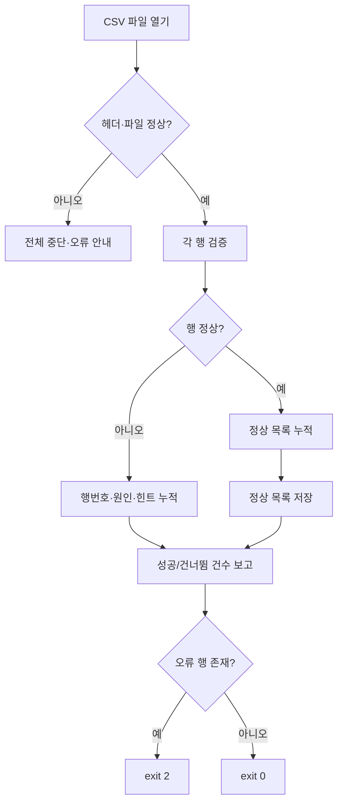

**도식 해설:** 한 번의 import에서 행별 검사 실패와 저장 자체의 실패를 구별한다. 부분 성공은 의도적 정책이지 무조건 원복되는 전체 롤백이 아니다. 사용자는 리포트로 불량 행을 정정한 뒤 재시도할 수 있다.

**내 구현 코드:** `service.py:import_csv,make_transaction`; `cli.py:main(import)`; `storage.py:save`. 위 경로의 함수명을 열고 입력값·반환값·실패 분기를 직접 보여주는 것이 답변의 근거다.

**VERIFY(시연·검증):** 기존 가상 검증은 정상 2행·불량 1행에서 `imported=2, skipped=1, exit=2`, 불량 3행의 힌트 출력을 확인했다. 동일 정상 CSV 재반입 시 중복 방지는 현재 미구현이다. 참고 증빙은 `../05-tests/WSL2-INDEPENDENT-VERIFICATION.md`와 `../06-evidence/WSL2-RUNTIME-2026-10-30.md`다. **답변 작성 자체는 신규 PASS가 아니다.**

**LIMITATION(한계·대안):** 부분 성공 후 같은 CSV를 다시 가져오면 정상 행이 중복될 수 있다. 실서비스에서는 미리보기·중복키·idempotency 도입을 고려한다.

**10초 답변:** “정상 행만 저장하고 불량 행은 번호·원인·힌트를 보고하며 오류가 있으면 종료 코드 2를 반환합니다.”

**30초 답변 예시:** “현재 구현은 **부분 성공 정책**이다. 정상 행을 저장하고 오류 행은 건너뛰며 행 번호·원인·해결 힌트·건수와 종료 코드 2를 제공한다. 사용자가 어떤 데이터가 들어갔고 무엇이 빠졌는지 알 수 있어야 중복 또는 누락을 방지할 수 있기 때문이다.”

**1분 답변 구성:** ① 무엇을 만들었는가 — 현재 구현은 **부분 성공 정책**이다. 정상 행을 저장하고 오류 행은 건너뛰며 행 번호·원인·해결 힌트·건수와 종료 코드 2를 제공한다. ② 왜 이 방법인가 — 사용자가 어떤 데이터가 들어갔고 무엇이 빠졌는지 알 수 있어야 중복 또는 누락을 방지할 수 있기 때문이다. ③ 실제 코드는 — `service.py:import_csv,make_transaction`; `cli.py:main(import)`; `storage.py:save` ④ 어떻게 확인하는가 — 기존 가상 검증은 정상 2행·불량 1행에서 `imported=2, skipped=1, exit=2`, 불량 3행의 힌트 출력을 확인했다. 동일 정상 CSV 재반입 시 중복 방지는 현재 미구현이다. ⑤ 한계는 — 부분 성공 후 같은 CSV를 다시 가져오면 정상 행이 중복될 수 있다. 실서비스에서는 미리보기·중복키·idempotency 도입을 고려한다. 이 순서로 본인 말로 설명하고 해당 함수를 열어 보여준다.

**예상 추가 질문(공식 확정 문항 아님):** 부분 성공과 전체 롤백 중 무엇을 선택했고, 재시도 중복은 어떻게 막겠습니까?

---

## 📌 전체 Mermaid — 요구사항부터 평가 설명까지


## 평가 현장용 시연 (새 데이터 사용, 실행 전에는 PASS 아님)

실행 위치는 **Repository 루트**이다. 아래 명령은 현재 구현에 맞춘 **재현 절차**이며 여기에서 새로 실행한 결과는 아니다.

```bash
# 1. 저장소 루트에서 시작: 기존 개인 데이터와 분리된 시험용 폴더
cd training/round-04-agent/04-src
export B2_EVAL_DATA="$(mktemp -d)"
echo "$B2_EVAL_DATA"

# 2. 기본 명령·카테고리 확인
PYTHONDONTWRITEBYTECODE=1 python3 -m budget_app --help
PYTHONDONTWRITEBYTECODE=1 python3 -m budget_app --data-dir "$B2_EVAL_DATA" category list

# 3. 거래 추가(날짜·유형·카테고리·금액·메모·태그를 차례대로 직접 입력)
PYTHONDONTWRITEBYTECODE=1 python3 -m budget_app --data-dir "$B2_EVAL_DATA" add

# 4. 목록·요약·예산(실제 입력한 날짜의 YYYY-MM로 교체)
PYTHONDONTWRITEBYTECODE=1 python3 -m budget_app --data-dir "$B2_EVAL_DATA" list --limit 5
PYTHONDONTWRITEBYTECODE=1 python3 -m budget_app --data-dir "$B2_EVAL_DATA" budget set --month 2026-10 --amount 5000
PYTHONDONTWRITEBYTECODE=1 python3 -m budget_app --data-dir "$B2_EVAL_DATA" summary --month 2026-10 --top 3

# 5. 별도 실행에서 계속 남아 있는 저장 파일 확인
ls -l "$B2_EVAL_DATA"/*.jsonl

# 6. 없는 거래 ID를 삭제하려고 시도하여 오류 코드 확인
PYTHONDONTWRITEBYTECODE=1 python3 -m budget_app --data-dir "$B2_EVAL_DATA" delete --id NO-SUCH-ID
echo "직전 명령의 종료 코드: $?"

# 7. 자동 검증: 저장소 루트에서 실행해야 하므로 cd로 돌아감
cd ../../../
PYTHONDONTWRITEBYTECODE=1 python3 training/round-04-agent/05-tests/runtime_cli_verification.py
```

> 6번은 **오류 종료가 예상**되는 의도적 부정 테스트다. 7번 스크립트는 독립 임시 폴더를 생성하여 검증한다. 개인 데이터 폴더에 테스트를 섞지 말고, `B2_EVAL_DATA` 경로의 필요 여부를 확인한 뒤 별도로 정리한다. 실제 출력에 비밀·개인 정보가 있으면 Evidence에서 제거한다.

### 설명할 때 구분해야 할 사실

| 구분 | 말해도 되는 표현 | 말하면 안 되는 표현 |
|---|---|---|
| 기존 런타임 증빙 | “10/30에 기록된 agent WSL2 시험은 29/29와 61회 PASS” | “내가 직접 모두 구술 시연하여 합격했다” |
| 구현 존재 | “해당 파일과 함수에 기능이 구현돼 있다” | “파일이 있으니 공식 평가 PASS다” |
| 성능 | “조회는 스트리밍, 쓰기는 전체 재작성 병목이 있다” | “10만 건에서도 성능을 검증했다” |
| 저장 안정성 | “os.replace 실패를 주입해 기존 파일 유지 검증” | “실제 전원 차단·동시 쓰기에도 완전 무결함” |
| CSV import | “일부 불량이면 정상 행 저장·리포트·exit 2” | “일부 불량이면 항상 전체 롤백한다” |

## 동료평가 진행 규칙과 증빙

별도 제공된 「동료 평가 규칙 확인」에 따라 동료평가는 **평가자와 피평가자가 캐빈의 피평가자 PC 앞에서 대면**으로 진행한다. 원격 평가와 동시 중복 평가는 금지된다. 코드 리뷰는 제출 저장소의 **기본 브랜치(Default Branch)** 기준이므로 PR에만 존재하는 문서를 공식 평가 대상과 혼동하지 않는다. 평가표에 없는 확인 질문도 가능하고, 자동시험 통과만으로 평가를 대신하지 않는다. 답변할 때 **무엇(WHAT), 이유(WHY), 구현(HOW), 검증(VERIFY), 한계(LIMITATION)**를 코드와 출력으로 논리적으로 연결해야 한다.

### 평가자·학습자 점검표

- [ ] 기존 평가표의 16개 질문을 보면서 각 코드 위치를 직접 찾을 수 있다.
- [ ] Mermaid 16개를 그림만 외우지 않고 입력→처리→출력 순서로 다시 설명할 수 있다.
- [ ] 새 시험용 데이터로 add/list/search/summary/budget/category/update/delete/import/export를 직접 수행했다.
- [ ] 잘못된 입력·파일 오류 및 종료 코드가 왜 그렇게 동작하는지 설명했다.
- [ ] 실제 수행 시각·환경·Git SHA·출력·스크린샷을 별도 Evidence에 기록했다.
- [ ] 과거 agent 증빙, 새 사용자 증빙, 공식 동료평가 결과를 섞지 않았다.
- [ ] 사용자 독립 구술과 대면 동료평가가 완료된 **경우에만** 최종 CLEAR 여부를 별도로 검토한다.

**문서 판정:** 설명 자료 작성 완료 · 기존 구현/증빙 연결 · 사용자 직접 시연/공식 동료평가/CLEAR는 **NOT_VERIFIED**.
